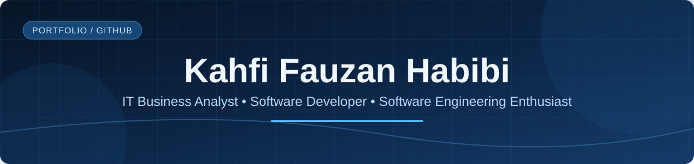

 

**Information Systems Graduate · Telkom University, 2026**  
**GPA 3.61 / 4.00 · BNSP Certified in Enterprise Architecture**

Building the bridge between **business needs**, **clear processes**, and **digital solutions**.

---

### About Me & Career Direction

I'm an **Information Systems graduate** with an interest in **IT Business Analysis**, Enterprise Architecture, and system development. I enjoy understanding business problems, organizing requirements, and exploring practical technology solutions.

- **Career focus:** IT Business Analyst · Business Process · Enterprise Architecture
- **Technical interests:** Web development · API integration · Mobile apps · Databases
- **Currently learning:** Flutter and modern development workflows

### Technical Toolkit

  <picture>
    <source media="(prefers-color-scheme: light)" srcset="https://www.gitskins.com/api/section/stack?username=KahfiFauzan&amp;theme=github-dark&amp;mode=light" />
    
  </picture>

### Selected Projects

| Project | Overview | Stack |
| :--- | :--- | :--- |
| **[TicketMaster — Project IAE](https://github.com/KahfiFauzan/Project-IAE)** | Transportation ticket management with separate booking, ticket, payment, route and vehicle services, connected through a GraphQL gateway. | Python · Flask · GraphQL · Docker |
| **[BotKML](https://github.com/KahfiFauzan/BotKML)** | Telegram bot to collect infrastructure mapping points and generate map images and KML output. | Node.js · Telegram Bot API |
| **[ListNote](https://github.com/KahfiFauzan/ListNote)** | A notes/list application developed as a Flutter learning project. | Flutter · Dart |

[**See all repositories**](https://github.com/KahfiFauzan?tab=repositories)

### GitHub Overview

<picture>
  <source media="(prefers-color-scheme: light)" srcset="https://www.gitskins.com/api/section/stats?username=KahfiFauzan&amp;theme=github-dark&amp;mode=light" />
  
</picture>

### Contribution Snake

<picture>
  <source media="(prefers-color-scheme: dark)" srcset="https://raw.githubusercontent.com/KahfiFauzan/KahfiFauzan/output/github-snake-dark.svg" />
  <source media="(prefers-color-scheme: light)" srcset="https://raw.githubusercontent.com/KahfiFauzan/KahfiFauzan/output/github-snake.svg" />
  
</picture>

---

**Open to opportunities in IT Business Analysis and related technology roles.**

[**Email me**](mailto:fauzankahfi28@gmail.com) · [**GitHub Projects**](https://github.com/KahfiFauzan?tab=repositories)

